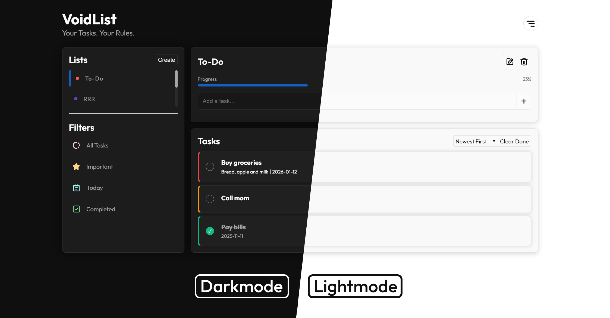

<br><br>


## 🧭 About
VoidList is a modern, privacy-first web app for managing multiple to-do lists and tasks.<br>
Designed for clarity, speed, and a delightful user experience. VoidList lets you <b>create and personalize</b> your lists - without ever compromising your data.
All data stays <b>100% on your device</b>.


## 🚀 Getting Started
VoidList runs instantly in your browser — no installation needed.<br>
Open the Web App: <a href="https://voidlist.netlify.app">VoidList Online</a>
<br><br>
Create your first list with a name and color. Add tasks, set priorities, and mark them as done.<br>
Personalize your experience in the settings.<br>
<b>Tip:</b> Your data is saved automatically in your browser. You can close the tab and return anytime - your lists will be there.

Creating a new list:  
Click the <kbd>+ New</kbd> button in the sidebar. Enter a list name and pick a color. Click <kbd>Create</kbd> and your list appears instantly.

Add & Manage Tasks:  
Select a list to view its tasks. Type a task and click <kbd>+</kbd> or hit 'Enter' of your keyboard to add.    
Click a task to edit details, set priority, or add a due date.  
Mark tasks as complete with a single click.  

Personalize Your Experience:  
Open settings <kbd>⚙</kbd> to...  
- Switch between Light, Dark, or System themes.  
- Toggle animations, progress bar, and more.

<br>



## ✅ Features
✔️ Multiple Lists: Create, color-code, and manage unlimited lists.  
✔️ Task Management: Add, edit, prioritize, and complete tasks.  
✔️ Persistent Storage: All data saved locally via localStorage.  
✔️ Themes: Light, Dark, and System (auto) modes.  
✔️ Settings: Toggle animations, progress bar,...  
✔️ Responsive UI: Works beautifully on desktop & mobile.  
✔️ No Tracking: No analytics, no ads, no cloud sync.  
✔️ Export/Import: Download your lists or share them.  
✔️ Keyboard & Touch Friendly: Fast, accessible controls.


## 📁 Project Structure
```
VoidList/     |
├─ assets/    | App icon, fonts, and SVG icons
├─ css/       | Stylesheets (base, components, modals, utils)
├─ js/        | JavaScript modules (main, ui, data, events, utils)
├─ index.html | Main HTML file
└─ README.md  | Project documentation
```


## 🛠️ Tech Stack


| Frontend                   | UI / UX                  | Data                      |
| -------------------------- | ------------------------ | ------------------------- |
| HTML5                      | SVG Icons                | localStorage (no backend) |
| CSS3 (modular, responsive) | 'Outfit' Font            | No frameworks / APIs      |
| Vanilla JS (modular, ES6+) | Local translation (i18n) | No dependencies           |

## 🔒 Data & Privacy
- **Your data never leaves your device.** 
- No cookies, no trackers, no analytics. 
- All lists and tasks are stored in your browser’s <kbd>localStorage</kbd> under the key <kbd> VoidList</kbd>. You can export or delete your data at any time.
```json
{
  "listName": {
    "color": "#2c3dd0",
    "tasks": [
      {
        "id": 1234567890,
        "name": "Buy groceries",
        "description": "Milk, eggs, bread",
        "priority": "medium",
        "dueDate": "2025-10-04",
        "completed": false
      }
    ]
  }
}
```

## 🛣️ Roadmap
📱 Optimize Smartphone-Layout  
🧰 Use predefined CSS variables  
♿ Accessability: Check BFSG + WCAG compliance  
📥 Import/Export improvements (export plain text, file handling,...)
📈 UI/UX: favicon handling, custom notifications (pop-up & toasts)  
🎞️ Add a startup animation  
🖼️ Improve documentation
🔄 Device Sync?  

## 📄 License & Disclaimer
The source code is the exclusive intellectual property of the author and is provided for informational purposes only.
No part of the code, in whole or in part, may be copied, modified, redistributed, or used to create derivative works without explicit prior written permission.

No warranties or guarantees are made regarding the accuracy, completeness, or suitability of this app or its content.
The author is not liable for any damages, losses, or issues resulting directly or indirectly from use of this app.
It is the user's responsibility to periodically review and stay informed of any updates to the license and usage terms.

<br>

> **Questions or feedback?**  
> Contact me: [&#70;&#52;&#66;&#105;&#76;&#76;&#64;&#112;&#114;&#111;&#116;&#111;&#110;&#46;&#109;&#101;](mailto:&#102;&#52;&#98;&#105;&#108;&#108;&#43;&#118;&#111;&#105;&#100;&#108;&#105;&#115;&#116;&#64;&#112;&#114;&#111;&#116;&#111;&#110;&#46;&#109;&#101;)

<br>
<p align="center" style="font-size:13px;">&copy; F4BiLL 2026. All rights reserved.</p>
